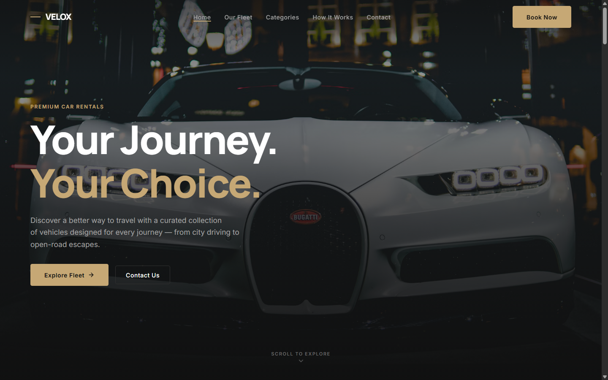
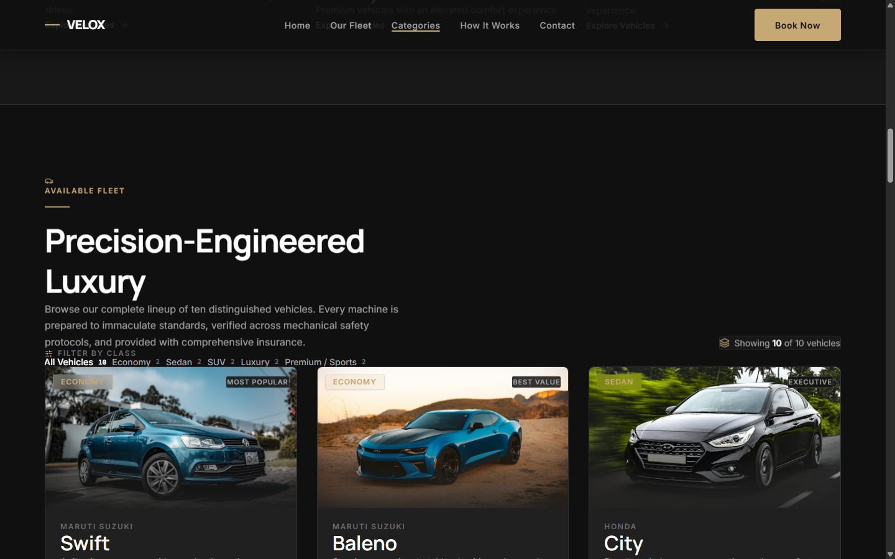
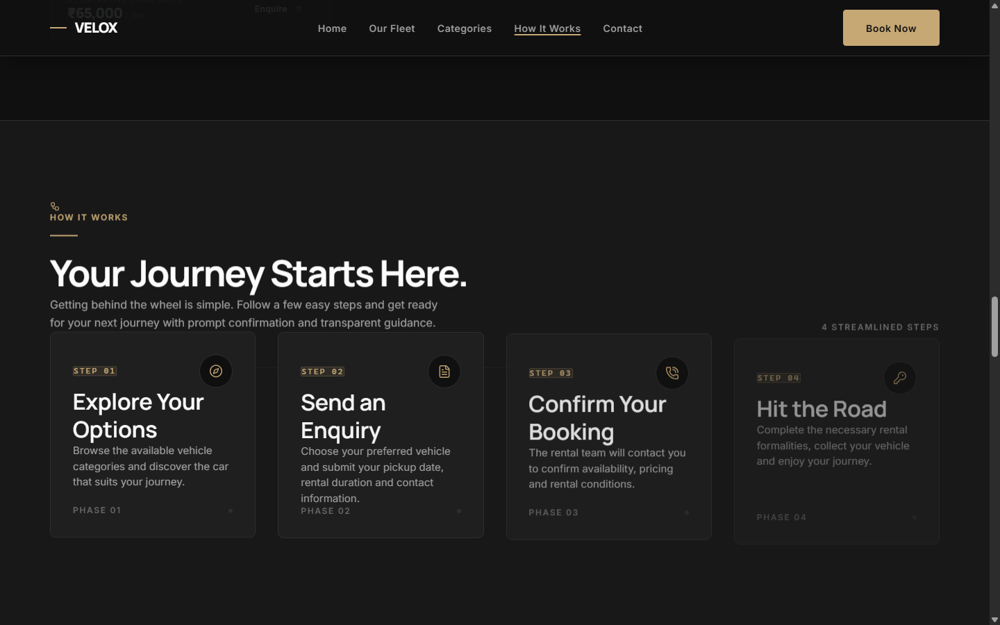
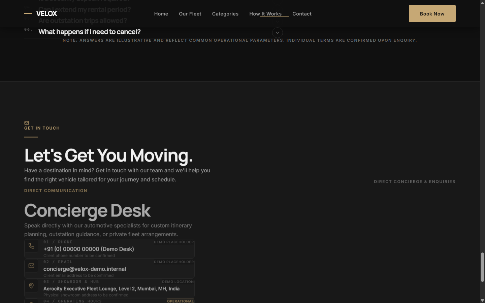
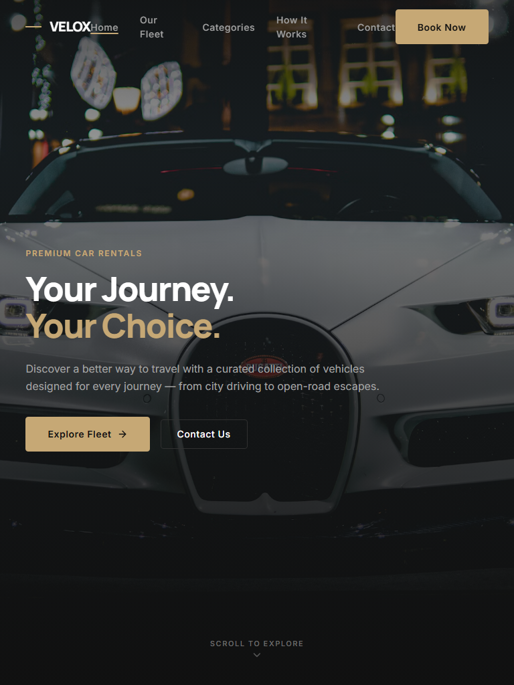
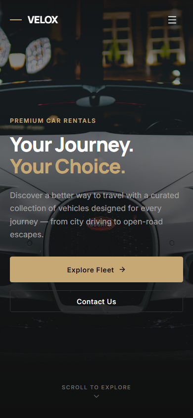
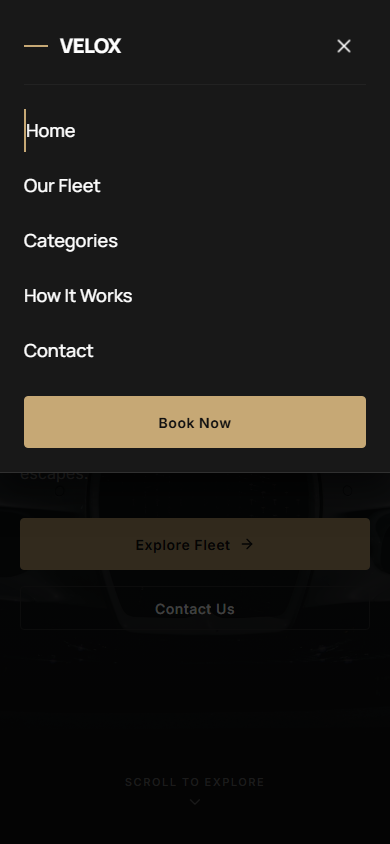
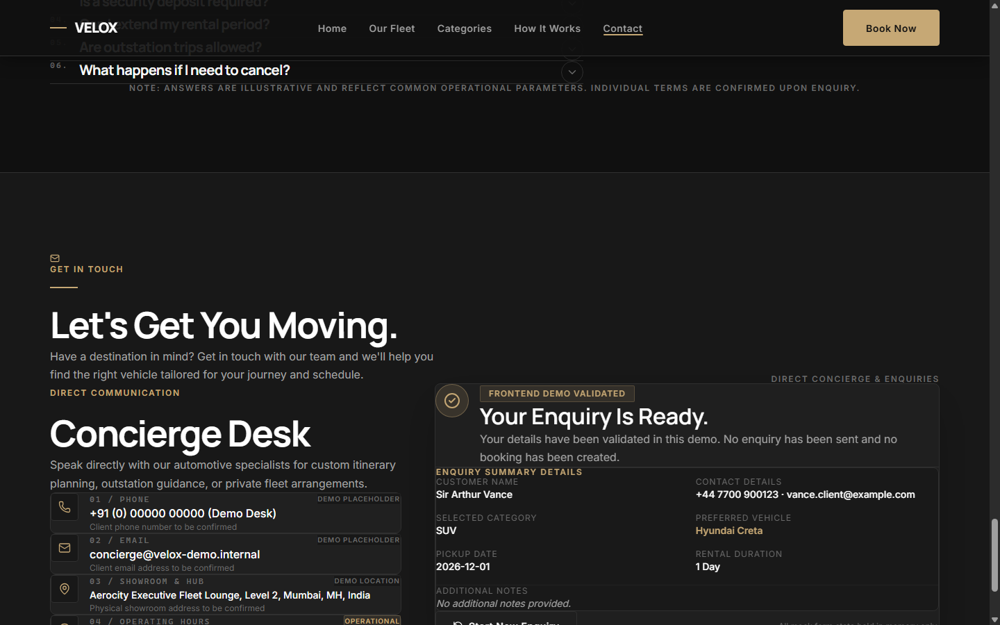

# VELOX — Premium Car Rental

A high-performance, editorial-grade luxury car rental landing page engineered with React 19, Vite 8, Tailwind CSS v4, Motion for React, and Lenis smooth scrolling.

> **Mandatory Demo Notice:**  
> **VELOX is a fictional frontend demonstration created to showcase a premium car-rental website concept. Vehicle listings, prices, contact details and rental policies are illustrative.**

---

## 🌐 Demonstrations & Links

- **Local Development Environment:** `http://localhost:5173/`
- **Source Code Repository (GitHub):** [https://github.com/rithvikhere/rentaldemo](https://github.com/rithvikhere/rentaldemo)
- **Deployment Ready:** Configured for one-click Vercel deployment (`vercel.json`)
- **Interactive Presentation Deck:** [`docs/VELOX_Client_Presentation.html`](docs/VELOX_Client_Presentation.html)
- **Executive Presentation Markdown:** [`docs/VELOX_Client_Presentation.md`](docs/VELOX_Client_Presentation.md)

---

## 📸 Screenshots & Visual Evidence

| Desktop Hero & Navigation | Desktop Fleet Showcase |
| :---: | :---: |
|  |  |
| **Booking Process Timeline** | **Contact & Enquiry Form** |
|  |  |
| **Tablet Viewport (768×1024)** | **Mobile Hero (390×844)** |
|  |  |
| **Mobile Drawer Navigation** | **Reservation Confirmation State** |
|  |  |

---

## 🛠️ Technology Stack

| Package | Version | Role |
| :--- | :--- | :--- |
| **React** | `^19.3.1` | Modern UI library with concurrent rendering & actions |
| **React DOM** | `^19.3.1` | DOM renderer for React |
| **Vite** | `^8.3.5` | Next-generation frontend tooling and bundler |
| **Tailwind CSS** | `^4.3.3` | Utility-first styling engine via `@theme` token definitions |
| **@tailwindcss/vite** | `^4.3.3` | Seamless Vite plugin for Tailwind v4 |
| **Motion** | `^14.9.0` | Production animation library with reduced-motion support |
| **Lenis** | `^1.3.27` | Smooth inertial scrolling coordination |
| **Lucide React** | `^1.65.0` | Minimalist luxury icon system |
| **Oxlint** | `^1.89.0` | High-speed Rust-based JavaScript/JSX linter |

---

## 🚀 Getting Started

### Prerequisites
- Node.js `^20.19.0` or `>=22.0.0`
- npm `^10.0.0` or higher

### Installation
```bash
git clone https://github.com/rithvikhere/rentaldemo.git
cd rentaldemo
npm install
```

### Local Development
```bash
npm run dev
# Server starts at http://localhost:5173
```

### Code Quality & Linting
```bash
npm run lint
# oxlint checks 22 files with 0 errors and 0 warnings
```

### Production Build & Preview
```bash
npm run build
# Generates minified static assets in dist/ (~750ms)

npm run preview
# Serves local production build at http://localhost:4173
```

---

## 📁 Project Structure

```
rentaldemo/
├── docs/
│   ├── screenshots/            # 10 verified browser screenshots (Desktop, Tablet, Mobile)
│   ├── VELOX_Client_Presentation.md   # 8-slide executive brief
│   └── VELOX_Client_Presentation.html # Interactive browser-based presentation deck
├── public/
│   ├── favicon.svg             # Gold monogram favicon
│   └── icons.svg               # SVG asset definitions
├── src/
│   ├── animations/
│   │   └── variants.js         # Standardised Motion fade, stagger, and slide variants
│   ├── assets/
│   │   ├── images/             # Automotive imagery
│   │   └── README.md           # Asset licensing and dimension guides
│   ├── components/
│   │   ├── Navbar.jsx          # Fixed frosted navigation with mobile drawer
│   │   ├── Hero.jsx            # Dynamic headline clamp & primary/secondary CTAs
│   │   ├── Categories.jsx      # 5 vehicle segments with direct filter actions
│   │   ├── Fleet.jsx           # Filterable fleet grid (10 vehicles)
│   │   ├── VehicleCard.jsx     # Technical specs (0-60, speed, transmission, seats)
│   │   ├── BookingProcess.jsx  # 4-stage chronological timeline
│   │   ├── RentalRequirements.jsx # Age, licensing, and deposit rules
│   │   ├── RentalInformation.jsx  # Policies, insurance, and mileage tables
│   │   ├── FAQ.jsx             # Accessible single-open accordion
│   │   ├── ContactInfo.jsx     # Direct phone, email, and concierge cards
│   │   ├── EnquiryForm.jsx     # Client-side validated form with fleet prefill
│   │   └── index.js            # Barrel exports
│   ├── data/
│   │   ├── cars.js             # Centralised vehicle fleet dataset
│   │   ├── contactInfo.js      # Contact definitions & placeholder flags
│   │   ├── faqData.js          # Frequently asked questions dataset
│   │   └── rentalInfo.js       # Rental steps and operational requirements
│   ├── hooks/
│   │   └── useLenis.js         # Smooth inertial scroll lifecycle hook
│   ├── App.jsx                 # Main layout coordinator & skip-to-content anchor
│   ├── index.css               # Design system tokens & global luxury styles
│   ├── main.jsx                # Application root mounting
│   └── design-system.md        # Complete brand UI/UX design specifications
├── index.html                  # Metadata, preconnect, and font imports
├── package.json                # Project dependencies and npm scripts
├── vercel.json                 # Turn-key Vercel deployment configuration
├── vite.config.js              # Vite configuration with relative base './'
└── README.md                   # Project documentation
```

---

## 🎨 Design System Summary

- **Theme:** Dark Luxury × Modern Minimalism × Automotive Editorial
- **Obsidian Dark Palette:**
  - Primary Background: `#101010`
  - Secondary Surface: `#101010`
  - Card Platter: `#202020`
  - Accent Gold: `#C6A875` (Hover: `#D9BF96`, Active: `#A8894E`)
  - Border: `#303030`
- **Typography:**
  - Headings: `Manrope` (Weights 300–800)
  - Body & UI: `Inter` (Weights 300–600)
- Full documentation: [`src/design-system.md`](src/design-system.md)

---

## 🚀 Deployment via Vercel

A turn-key `vercel.json` configuration is included at root:
```json
{
  "buildCommand": "npm run build",
  "outputDirectory": "dist",
  "framework": "vite",
  "rewrites": [
    { "source": "/(.*)", "destination": "/index.html" }
  ]
}
```

**Steps to deploy directly on Vercel:**
1. Open [vercel.com/new](https://vercel.com/new).
2. Connect your GitHub account and import `rithvikhere/rentaldemo`.
3. Vercel automatically detects the Vite framework and settings.
4. Click **Deploy**.

---

## ⚠️ Demo Scope & Disclaimer

VELOX is an illustrative frontend demonstration. This application does not contain a backend database, payment gateway, authentication system, or live vehicle tracking telematics. No actual reservations are created or submitted. All vehicle specifications and rates are illustrative.
